<p align="center">
<picture>
  <source media="(prefers-color-scheme: dark)" srcset="https://raw.githubusercontent.com/ntanwir10/ntanwir10/cards/about-dark.svg">
  
</picture>
<picture>
  <source media="(prefers-color-scheme: dark)" srcset="https://raw.githubusercontent.com/ntanwir10/ntanwir10/cards/summary-dark.svg">
  
</picture>
</p>

<p align="center">
  <a href="https://linkedin.com/in/naumantanwir">LinkedIn</a> ·
  <a href="https://naumantanwir-dev.vercel.app">Portfolio</a> ·
  <a href="mailto:ntanwir10@gmail.com">Email</a> ·
  <a href="https://buymeacoffee.com/ntanwir10">Buy Me A Coffee</a>
</p>

I’m a Senior Software Engineer with Staff-level scope, focused on backend systems, cloud infrastructure, and production reliability on AWS.

I design distributed systems, define infrastructure and deployment patterns, and stay deeply hands-on building backend services using Python (FastAPI) and Node.js. My work spans architecture decisions, infrastructure as code with Terraform, CI/CD automation, and operating systems in production.

I care about how systems behave after they ship. Reliability, observability, security, and cost efficiency are first-class concerns in everything I build.

**Currently focused on backend, cloud, and platform-oriented roles.**

---

## What I Do

- Design backend and service architectures for scalable systems
- Build and operate cloud infrastructure on AWS using Terraform
- Develop backend services and APIs in Python (FastAPI) and Node.js
- Design event-driven and serverless systems (SQS, SNS, Lambda)
- Own CI/CD pipelines, deployment safety, and environment isolation
- Improve production reliability through observability and automation
- Mentor engineers and review designs to keep systems coherent

Front-end work (React) is something I step into when needed, but backend, cloud, and infrastructure are my primary focus areas.

---

## Technical Stack

```python
stack = {
    "Backend & APIs": [
        "Python (FastAPI)", "Node.js", "REST", "GraphQL", "Microservices", "Serverless",
    ],
    "Cloud & DevOps": [
        "AWS", "Terraform", "Docker", "Kubernetes", "GitHub Actions", "GitLab CI/CD",
    ],
    "Data & Messaging": [
        "PostgreSQL", "DynamoDB", "Redis", "SQS", "SNS", "Kafka",
    ],
    "Security & Operations": [
        "IAM", "KMS", "Secrets Manager", "Monitoring", "Alerting", "Incident response",
    ],
}
```

---

## Selected Projects

| Project | What it is |
| --- | --- |
| [**GuardScan**](https://guardscancli.vercel.app) | Local-first security scanning and AI code review CLI for secure developer workflows |
| [**CodeSage**](https://github.com/ntanwir10/codesage) | Backend-heavy code discovery platform built with Python and FastAPI |
| [**AI-Driven Distributed Anomaly Detection**](https://github.com/ntanwir10/AI-Anamoly-Detector) | Distributed anomaly detection using Redis Bloom and Redis Gears |
| [**AWS Cloud Uploader CLI**](https://github.com/ntanwir10/Bash-CloudUploaderCLI_AWS) | Shell-based AWS automation tool for secure object uploads and basic lifecycle management |

## Additional Systems & Experiments

These are smaller or exploratory systems that focus on specific engineering problems rather than full platforms.

| Project | What it is |
| --- | --- |
| [**Real-time AI Dungeon Master**](https://github.com/ntanwir10/realtime_ai_dungeon_master) | Real-time, stateful system coordinating AI-driven interactions with low-latency event handling |
| [**localLedger**](https://github.com/ntanwir10/localLedger) | Cloud-native financial tracking application for small businesses and individuals, offering real-time expense tracking, automated reporting, and secure data management on Azure. |

---

## GitHub Activity

<!-- cool-readme:start -->
<!-- Cards by github-cool-readme: https://github.com/pedrocatalao/github-cool-readme -->
<p align="center">
<picture>
  <source media="(prefers-color-scheme: dark)" srcset="https://raw.githubusercontent.com/ntanwir10/ntanwir10/cards/languages-dark.svg">
  
</picture>
<picture>
  <source media="(prefers-color-scheme: dark)" srcset="https://raw.githubusercontent.com/ntanwir10/ntanwir10/cards/repos-dark.svg">
  
</picture>
</p>
<p align="center">
<picture>
  <source media="(prefers-color-scheme: dark)" srcset="https://raw.githubusercontent.com/ntanwir10/ntanwir10/cards/weekly-dark.svg">
  
</picture>
<picture>
  <source media="(prefers-color-scheme: dark)" srcset="https://raw.githubusercontent.com/ntanwir10/ntanwir10/cards/streaks-dark.svg">
  
</picture>
</p>
<!-- cool-readme:end -->

---

## Engineering Principles

- Design for failure and recovery, not the happy path
- Treat infrastructure and deployments as first-class code
- Make system behaviour observable before optimizing it
- Prefer simple, explicit architectures over clever abstractions
- Optimize for long-term ownership, not short-term delivery
