<p align="center">
<picture>
  <source media="(prefers-color-scheme: dark)" srcset="https://raw.githubusercontent.com/ntanwir10/ntanwir10/cards/about-dark.svg">
  
</picture>
<picture>
  <source media="(prefers-color-scheme: dark)" srcset="https://raw.githubusercontent.com/ntanwir10/ntanwir10/cards/summary-dark.svg">
  
</picture>
</p>

<p align="center">
  <a href="https://linkedin.com/in/naumantanwir">LinkedIn</a> ·
  <a href="https://naumantanwir-dev.vercel.app">Portfolio</a> ·
  <a href="mailto:ntanwir10@gmail.com">Email</a> ·
  <a href="https://buymeacoffee.com/ntanwir10">Buy Me A Coffee</a>
</p>

I’m a Senior Software Engineer and Technical Lead with 7+ years of experience building backend systems, cloud infrastructure, and full-stack applications. My strongest work sits where software engineering meets reliable delivery: designing APIs, improving system performance, automating infrastructure, and making production systems easier to operate.

I enjoy solving engineering problems beyond the happy path, particularly around reliability, failure recovery, system design, developer experience, and cloud infrastructure. I value straightforward architecture, good technical judgment, and staying hands-on while helping other engineers deliver better software.

📍 Based in Toronto. **Open to senior engineering and technical leadership roles across Backend Engineering, Platform Engineering, Cloud Infrastructure, and Developer Tools.**

🏅 [AWS Certified Solutions Architect – Associate](https://www.credly.com/badges/cb01feb1-f290-4afc-aa9e-145b4302606a)

---

## What I Do

- Lead architecture and technical delivery for production backend systems
- Build backend services and APIs in Node.js, TypeScript, and Python (FastAPI)
- Design event-driven and serverless workflows on AWS (Lambda, API Gateway, SQS/SNS, DynamoDB) with retries, idempotency, and failure recovery
- Build and operate cloud infrastructure with Terraform, Docker, and CI/CD pipelines
- Tune PostgreSQL/Aurora queries, indexes, and Redis caching for latency and cost
- Improve production reliability through observability, structured logging, and automation
- Mentor engineers through design reviews, code reviews, and releases

I started in front-end (React, Redux) and still step in when needed, but backend, cloud, and infrastructure are my primary focus areas.

---

## Technical Stack

```python
stack = {
    "Backend & APIs": [
        "Node.js", "TypeScript", "Python (FastAPI)", "Express.js",
        "REST", "GraphQL", "Microservices", "Serverless",
    ],
    "Cloud & DevOps": [
        "AWS", "Terraform", "Docker", "Kubernetes", "GitHub Actions", "GitLab CI/CD",
    ],
    "Data & Messaging": [
        "PostgreSQL", "Aurora", "DynamoDB", "Redis", "SQS", "SNS", "Kafka",
    ],
    "Security & Operations": [
        "IAM", "KMS", "Secrets Manager", "CloudWatch",
        "Monitoring", "Alerting", "Incident response",
    ],
    "Frontend": [
        "React", "Redux", "JavaScript",
    ],
}
```

---

## Selected Projects

| Project | What it is |
| --- | --- |
| [**ThoughtTap**](https://marketplace.visualstudio.com/items?itemName=ntanwir.thoughttap) | TypeScript/Node.js VS Code extension for context-aware AI prompt workflows, integrating multiple AI providers with bring-your-own-key configuration |
| [**CodeSage**](https://codesage-docs.vercel.app) | Python, FastAPI, and Algolia code discovery platform with repository ingestion, indexed search, and MCP integration for AI development tools |
| [**GuardScan**](https://guardscancli.vercel.app) | Open-source, local-first security scanning and AI code-review CLI built in TypeScript/Node.js |
| [**ShopperSprint**](https://shoppersprint.com) | Real-time product comparison app built with React, Node.js, PostgreSQL, Redis, and WebSockets |
| [**Real-time AI Dungeon Master**](https://github.com/ntanwir10/realtime_ai_dungeon_master) | Real-time, stateful system coordinating AI-driven interactions with low-latency event handling |
| [**AI-Driven Distributed Anomaly Detection**](https://github.com/ntanwir10/AI-Anamoly-Detector) | Distributed anomaly detection using Redis Bloom and Redis Gears |
| [**AWS Cloud Uploader CLI**](https://github.com/ntanwir10/Bash-CloudUploaderCLI_AWS) | Shell-based AWS automation tool for secure object uploads and basic lifecycle management |
| [**localLedger**](https://github.com/ntanwir10/localLedger) | Cloud-native financial tracking application for small businesses and individuals, offering real-time expense tracking, automated reporting, and secure data management on Azure. |

---

## GitHub Activity

<!-- cool-readme:start -->
<!-- Cards by github-cool-readme: https://github.com/pedrocatalao/github-cool-readme -->
<p align="center">
<picture>
  <source media="(prefers-color-scheme: dark)" srcset="https://raw.githubusercontent.com/ntanwir10/ntanwir10/cards/languages-dark.svg">
  
</picture>
<picture>
  <source media="(prefers-color-scheme: dark)" srcset="https://raw.githubusercontent.com/ntanwir10/ntanwir10/cards/repos-dark.svg">
  
</picture>
</p>
<p align="center">
<picture>
  <source media="(prefers-color-scheme: dark)" srcset="https://raw.githubusercontent.com/ntanwir10/ntanwir10/cards/weekly-dark.svg">
  
</picture>
<picture>
  <source media="(prefers-color-scheme: dark)" srcset="https://raw.githubusercontent.com/ntanwir10/ntanwir10/cards/streaks-dark.svg">
  
</picture>
</p>
<!-- cool-readme:end -->

---

## Engineering Principles

- Design for failure and recovery, not the happy path
- Treat infrastructure and deployments as first-class code
- Make system behaviour observable before optimizing it
- Prefer simple, explicit architectures over clever abstractions
- Optimize for long-term ownership, not short-term delivery
